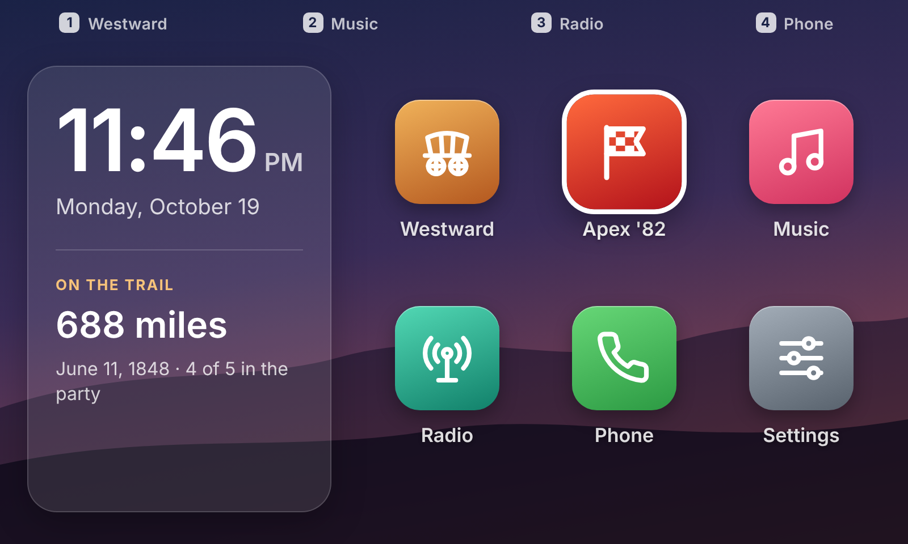
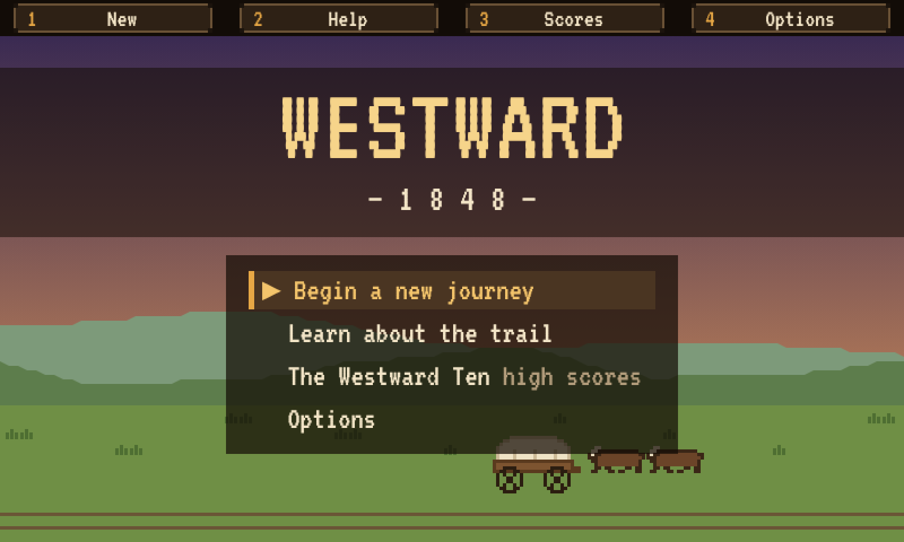
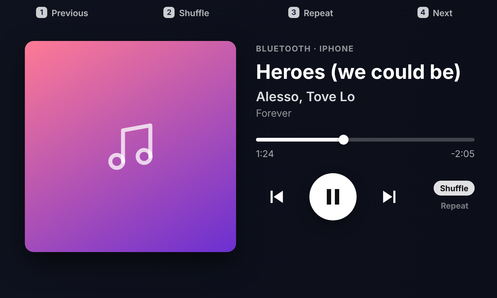
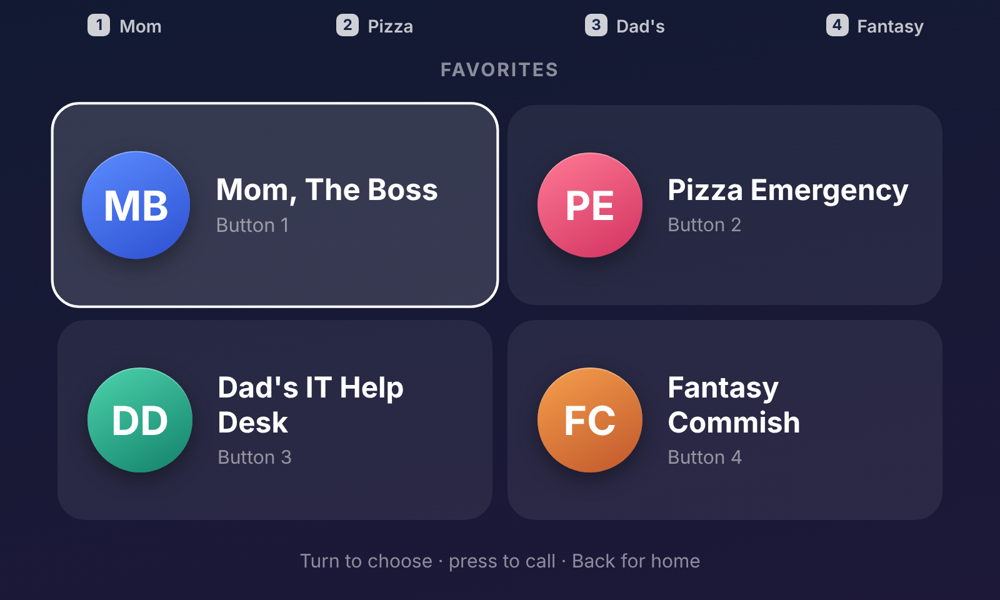
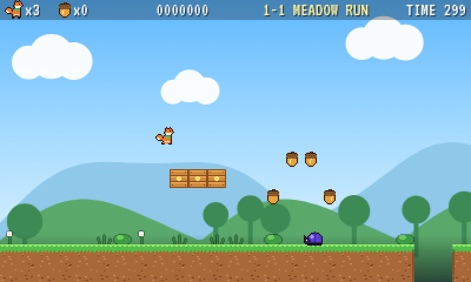
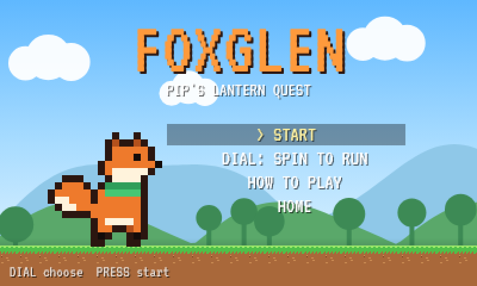
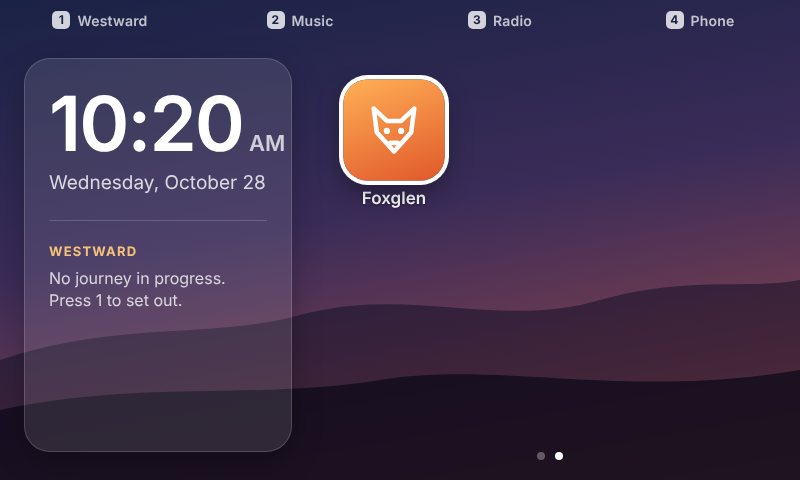

# Car Thing → Desk Computer

Spotify bricked the Car Thing at the end of 2024. This repo turns a jailbroken one into a little desk computer: an iPhone-style **home screen** you drive with the dial, three original games, a **now-playing screen** for your iPhone, and a **speed-dial** that calls your favorite contacts. Everything runs on the Car Thing itself and installs (and uninstalls) from a Mac over USB.



| | |
|---|---|
|  |  |
|  |  |
|  |  |
|  | |

## What's included

- **Home screen.** Two swipeable pages of apps (turn the dial past the last app, or swipe), with presets 1–4 as shortcuts, clock and date widget, and Settings for Bluetooth, dial direction, 12/24-hour clock and time zone.
- **Westward 1848.** An original Oregon Trail–style game: outfit a wagon, cross ~2,000 miles of trail with landmarks, forts and river crossings, plus hunting and rafting minigames, weather, illness and high scores.
- **Apex '82.** An original pseudo-3D arcade racer in a 16-bit style. The **dial steers** and **Back shifts LO/HI**. A qualifying lap sets your grid spot, then it's 4 laps against 7 rivals plus lapped traffic on a tight clock.
- **Foxglen.** An original side-scrolling platformer starring Pip the fox, across four worlds: Meadow, the Hollow caves, the Canopy treetops and Frostpeak. **Spin the dial to run** (spin faster to sprint) and press **Back or the dial to jump**. Stomp beetles, bees and spiders, avoid spiky burrs, bump crates for acorns, and find the feather, which gives you a double jump and a glide. There are checkpoints, moving logs, a lantern to light at the end of each level, and a throttle mode for the dial if you'd rather set your speed.
- **Music.** What's playing on your iPhone, from any app (title, artist, album, live progress), with play/pause, skip, shuffle and repeat. Audio stays on the phone.
- **Radio.** A scrollable UV-5R guide for Fargo-Moorhead: local channels (weather, repeaters, railroad, MURS) color-coded by whether you can transmit, all 22 FRS/GMRS channels, the 41 radio menu settings with suggested values, and the rules. Generated from a spreadsheet, so you can swap in your own area.
- **Phone.** A "stream deck" of favorite contacts. Pick one and press twice, and your iPhone dials. The call stays on the phone.
- **Calendar.** Your next events under the clock ("Now · until 1:00 PM", then what's next, then tomorrow), synced from Outlook, Google or iCloud by a small job on your Mac.
- **Sleep button.** The top-right button turns the screen and backlight off, and any touch wakes it.
- **Bluetooth that works.** A fix for the Car Thing's Bluetooth chip, which doesn't come up after the jailbreak, plus a pairing screen with an on-screen passkey.

## What you need

- A Spotify Car Thing and its USB-C cable.
- A Mac. The scripts are bash and use `adb`; Linux should work too but is untested.
- Google Chrome, for flashing the firmware.
- `adb`. If you have the [DeskThing](https://deskthing.app/) app, the scripts use its built-in copy. Otherwise run `brew install android-platform-tools`.
- An iPhone for Music and Phone. Android phones may work but are untested.

## Install

### 1. Jailbreak the Car Thing

Flash the community **Thing Labs** firmware with the **Terbium** web flasher in Chrome. Follow the [Car Thing wiki flashing guide](https://carthing.wiki/first-steps/flashing/). The short version: hold buttons **1 and 4** while plugging the Car Thing into your computer (the screen stays black), then flash from the browser. Flashing replaces the Spotify software, and stock firmware can be reflashed later.

### 2. Get this repo

```bash
git clone https://github.com/wyattwarkenthien/Car-Thing-Jailbreak.git
cd Car-Thing-Jailbreak/device
```

(Or download the ZIP from GitHub and open the `device` folder in Terminal.)

### 3. Install the home screen

Plug the Car Thing in **normally** (no buttons held), wait for it to finish booting, and quit the DeskThing app if it's open. Then:

```bash
bash install.sh
```

This backs up the original startup config (first run only), copies the home screen and apps to the Car Thing, points its browser at them, and reboots into the home screen.

### 4. Turn on Bluetooth (for Music and Phone)

```bash
bash install-bluetooth.sh
```

Then on the Car Thing, go to **Settings › Bluetooth › Search for devices**. On your iPhone, open **Settings › Bluetooth** so it's discoverable, pick it on the Car Thing, and confirm that the 6-digit codes match on both screens.

### 5. Keep the clock set

The Car Thing has no clock battery and no time zone data. Run `bash ../mac/calendar/install-calendar.sh` (you can skip the calendar link): it sets the clock every 5 minutes whenever the Car Thing is plugged into your Mac. Then on the Car Thing, set **Settings › Time zone**. (`sync-time.sh` still works for a one-off.)

### 6. Add your favorite contacts (for Phone)

```bash
cp favorites.example.json home/favorites.json
open -e home/favorites.json      # put in names and numbers, up to 8
bash update.sh
```

`home/favorites.json` is git-ignored, so your contacts never end up in a commit.

## Controls

| | Dial (turn) | Dial (press) | Back | 1 | 2 | 3 | 4 |
|---|---|---|---|---|---|---|---|
| **Home** | move | open | – | Westward | Music | Radio | Phone |
| **Westward 1848** | move / adjust | select | back / stop wagon (hold to go home) | shortcuts shown on screen | | | |
| **Apex '82** | steer | gas (manual mode) | shift LO/HI | brake | pause | gas mode (title) | gas (manual mode) |
| **Foxglen** | spin to run | jump | jump | hold: walk left | hold: walk right | pause | jump |
| **Radio** | scroll | open/close details | close / home | Channels tab | FRS/GMRS tab | Menu tab | Info tab |
| **Music** | – | play / pause | home | previous | shuffle | repeat | next |
| **Phone** | choose | confirm, then call | cancel / home | favorite 1 | favorite 2 | favorite 3 | favorite 4 |

**Top-right button (next to the presets): sleep.** Turns the screen and backlight off anywhere, including mid-game, which freezes. Any button, dial turn or tap wakes it without triggering anything. If your Car Thing's top-right button doesn't sleep the screen, check **Settings › Button test** to see what it sends.

The touchscreen works too.

## Show your calendar under the clock

Any calendar that can give you a private **.ics link** works: Outlook / Microsoft 365, Google Calendar, iCloud.

1. Get the link.
   - **Outlook (web):** Settings › Calendar › Shared calendars › *Publish a calendar* › pick your calendar and **Can view all details** › Publish › copy the **ICS** link. Some work accounts have publishing turned off by IT.
   - **Google:** Calendar settings › your calendar › *Secret address in iCal format*.
   - **iCloud:** Calendar app › share calendar › *Public Calendar*, then copy the `webcal://` link.
2. On your Mac: `bash mac/calendar/install-calendar.sh` and paste the link (or press Return to skip the calendar and only sync the clock).

The same job also **keeps the Car Thing's clock right**: it has no clock battery, so it forgets the time whenever it loses power. Every 5 minutes, while it's plugged into the Mac, the job sets the clock and copies the next 7 days of events to it with `adb push` (to `/var/carthing/calendar.json`). Recurring meetings, skipped or moved instances, all-day events and Windows time zone names are handled. The link is stored only on your Mac (`~/Library/Application Support/carthing-calendar`, readable only by you), and anyone with the link can read the calendar, so treat it like a password. Remove it with `bash mac/calendar/uninstall-calendar.sh`.

## Make the Radio guide your own

The Radio app is generated from `home/tools/UV-5R_Fargo_Guide.xlsx`. To use your own area, edit the workbook (same sheet and column layout), then run:

```bash
cd home
pip install openpyxl
python3 tools/radio_from_xlsx.py tools/UV-5R_Fargo_Guide.xlsx
node build.mjs && bash ../device/update.sh
```

## Updating

After pulling new changes, or editing `home/favorites.json`, run:

```bash
bash update.sh
```

To change the code itself, rebuild first (needs Node 18+). Run `bash build.sh` from the repo root, then `bash device/update.sh`.

## Troubleshooting

- **"Car Thing not found."** Plug it in without holding any buttons and let it finish booting. Quit the DeskThing app, which can hold the USB connection, and unplug and replug if needed.
- **Stuck on the old DeskThing screen.** Give it a minute after an update. If it's still stuck, run `bash ../tools/check-browser.sh`, which reads the browser's logs and restarts it.
- **Clock shows --:-- or the wrong time.** The Car Thing lost power and forgot the time. Plug it into your Mac (with the calendar/clock job installed it fixes itself within 5 minutes, or run `sync-time.sh`), and check **Settings › Time zone**.
- **Bluetooth not working.** Run `bash ../tools/check-bluetooth.sh` for a read-only report. If the chip didn't wake at boot, re-run `install-bluetooth.sh`.
- **iPhone keeps connecting and disconnecting.** The original Spotify app still runs in the background and can interfere. Unplug and replug the Car Thing, then re-run `install-bluetooth.sh`.
- **General health check.** `bash ../tools/check.sh` shows what the Car Thing boots into, what's installed, and its clock next to your Mac's.

The `tools/` scripts only read from the device, except `check-browser.sh`, which restarts the browser once.

## Uninstall

```bash
bash restore.sh
```

This puts the original startup config back, which also removes the Bluetooth services, and reboots.

## How it works

- **The "firmware" is a web page.** After the Thing Labs jailbreak, the Car Thing boots a small Linux system that starts a full-screen Chromium pointed at one local HTML file. `install.sh` installs this project to `/usr/share/carthing-home/` and changes that one `--app=` line in `/etc/supervisord.conf`. Every app is a single, self-contained, offline HTML file, built for the device's old Chromium.
- **The Bluetooth fix.** The Car Thing's Broadcom BCM20703A2 sits on `/dev/ttyS1`, and after the jailbreak it never answers: every HCI command times out. Power-cycling `gpio493` before attaching (`btattach -P bcm`) brings it up. `bt/btwake.sh` runs at boot via supervisord.
- **Music.** The stock Bluetooth service only loads the `gap,deviceinfo` plugins. `install-bluetooth.sh` restarts it with `avrcp` (no A2DP, so audio stays on the phone). The helper opens the AVRCP channel the moment the phone connects, because without it the iPhone drops the idle link after about a second. Track info comes from BlueZ's `org.bluez.MediaPlayer1`, read with `gdbus`, since the device's Python has no D-Bus module.
- **Phone.** The Car Thing briefly acts as a hands-free kit (HFP). It finds the iPhone's Handsfree Audio Gateway channel with `sdptool`, opens RFCOMM from Python, does the handshake (`AT+BRSF`, `AT+CIND`, `AT+CMER`), sends `ATD<number>;`, waits for the phone to report the outgoing call, then disconnects so the call stays on the phone.
- **The helper** (`bt/bthelper.py`) is a small standard-library Python service on `127.0.0.1:8737`. It drives `bluetoothctl` as the pairing agent, serves the Settings, Music, Phone and calendar screens, and handles sleep: it stops the ambient-light `backlight` service and writes `bl_power`/`brightness` under `/sys/class/backlight`.

**Lesson learned:** on this firmware, setting up an `adb reverse` tunnel (Car Thing → Mac) knocks the Car Thing off USB until it reboots. `adb forward` (Mac → Car Thing) is fine. See `experimental/spotify-link/`.

## Repo layout

| Path | What it is |
|---|---|
| `device/` | **Start here.** Install, update, restore, Bluetooth and clock scripts, plus the built files that go on the Car Thing (`device/home/`). |
| `home/` | Home screen source: TypeScript UI (`src/`) and the on-device Bluetooth helper (`bt/`). |
| `mac/calendar/` | Runs on the Mac: syncs your calendar (.ics) to the Car Thing every 5 minutes. |
| `shared/` | Code shared by the home screen and games (screen sleep). |
| `source/` | Westward 1848 source. |
| `foxglen/` | Foxglen source: game in `src/main.ts`, levels built with a small builder in `src/levels.ts`, pixel art drawn in code in `src/art.ts`. |
| `racer/` | Apex '82 source: engine and race in `src/main.ts`, procedurally drawn sprites in `src/art.ts`. |
| `tools/` | Diagnostic scripts. |
| `experimental/` | The Spotify-over-USB attempt. Don't use it as-is; see its WARNING. |
| `build.sh` | Rebuilds everything into `device/home/`. |

## Credits

- Jailbreak: [Thing Labs](https://github.com/thinglabsoss) firmware and the Terbium flasher; the [Car Thing wiki](https://carthing.wiki/).
- Fonts: VT323 by Peter Hull and Inter by Rasmus Andersson, both under the SIL Open Font License.
- Westward 1848, Apex '82 and Foxglen are original games inspired by the classics. They aren't affiliated with or endorsed by the owners of those games, and all their art and writing is original.
- Built by [Wyatt Warkenthien](https://warkenthien.us), with Claude as pair programmer.

## License

MIT. See [LICENSE](LICENSE). Fonts keep their own license (SIL OFL 1.1).
